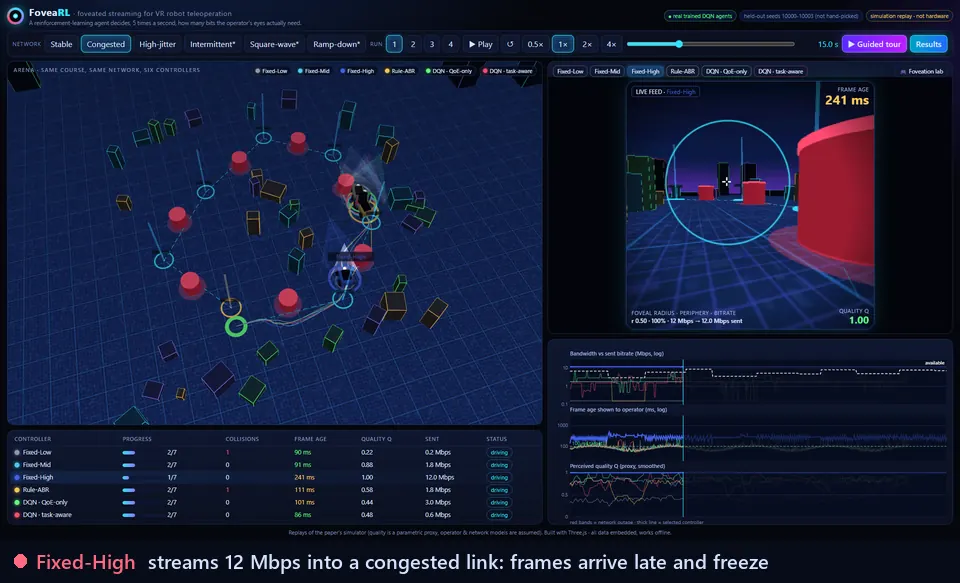
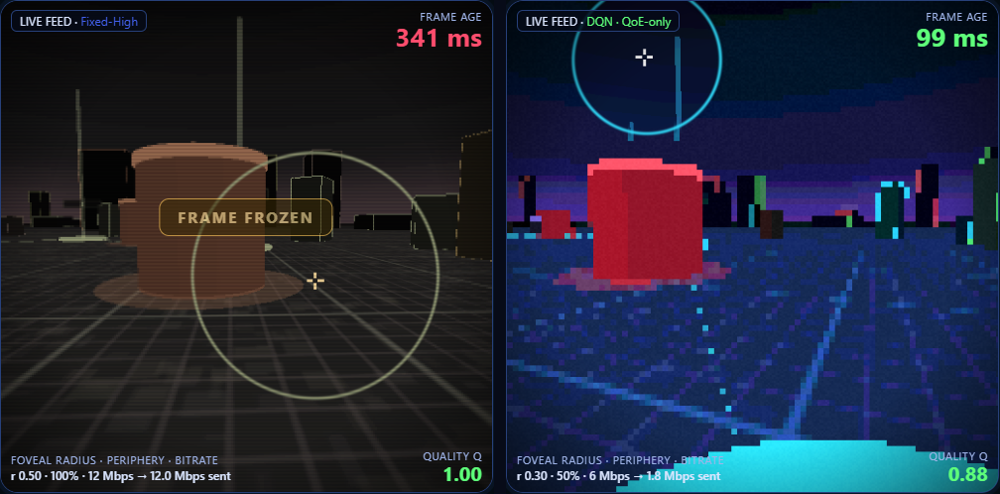
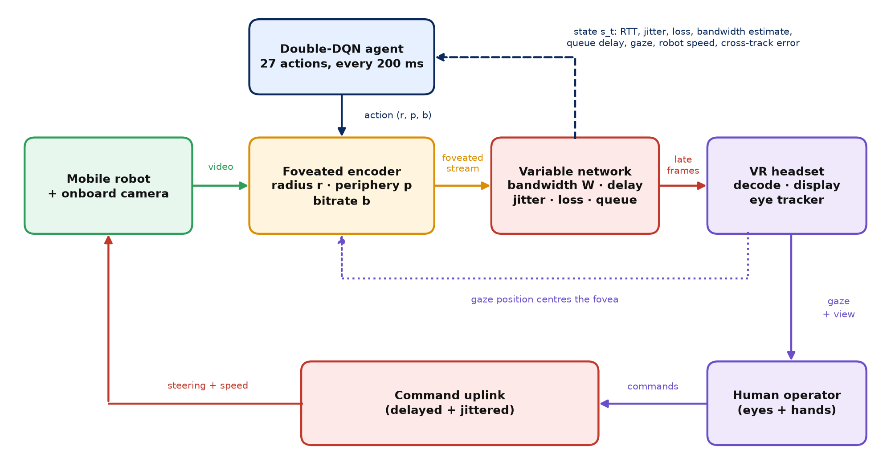
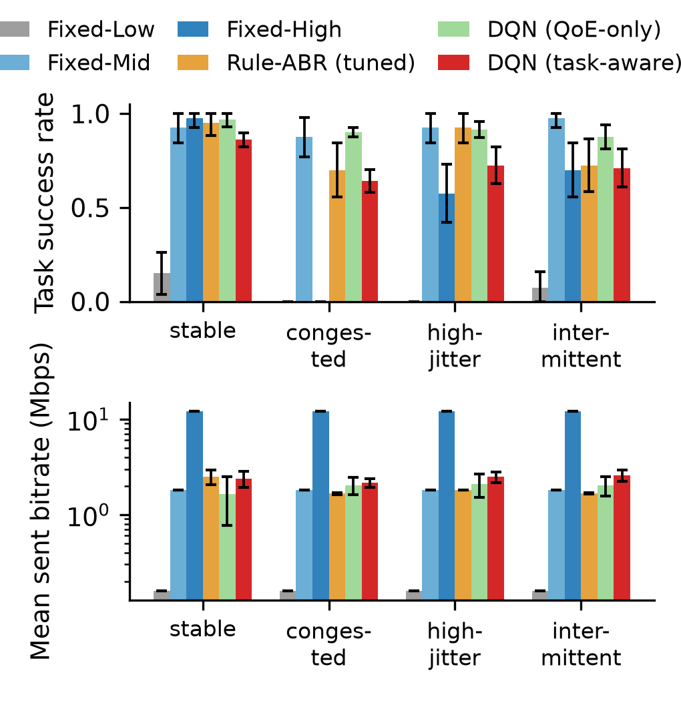
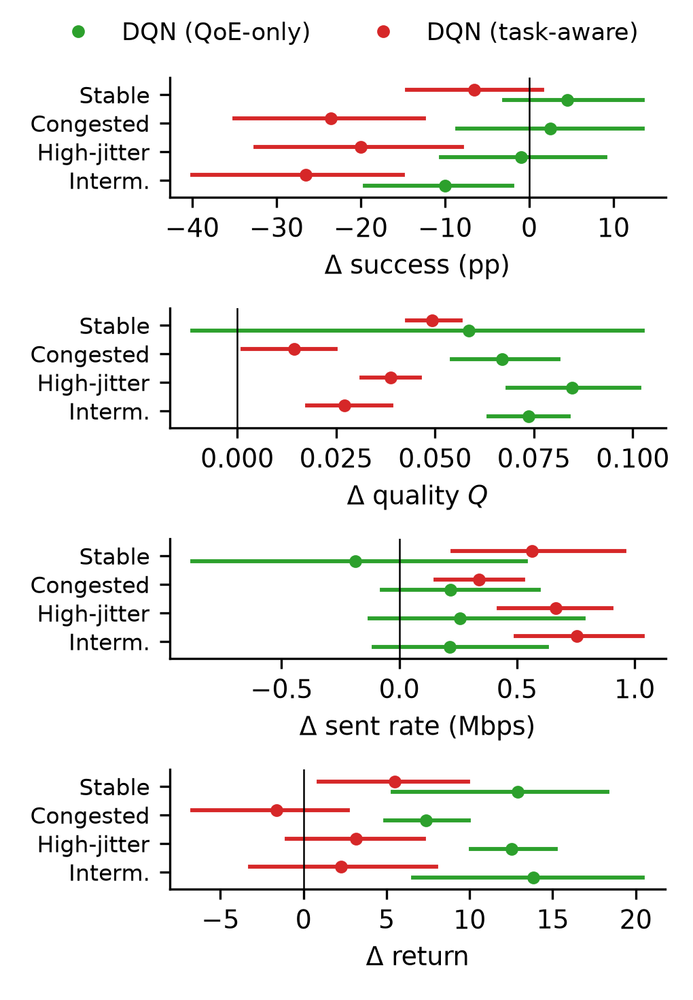
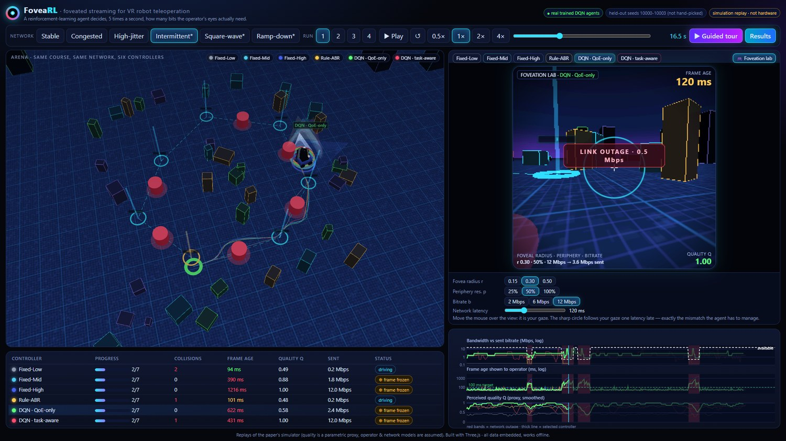
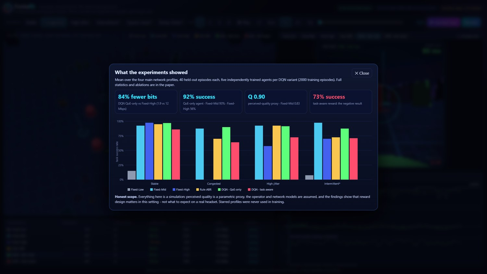

<div align="center">

# FoveaRL

**Reinforcement-learning foveated streaming for VR teleoperation of mobile robots,<br>and a controlled study of what the reward should contain.**

[](https://rishijayanath24-cpu.github.io/FoveaRL/)
[](vr_teleop_rl/results/)
[](https://github.com/rishijayanath24-cpu/FoveaRL/actions/workflows/ci.yml)




<sub>Same course, same congested link, same seed: six controllers drive at once. This is a replay of real trained agents from the paper's simulator, not an animation.</sub>

**[▶ Open the live demo](https://rishijayanath24-cpu.github.io/FoveaRL/)** &nbsp;·&nbsp; **[📊 See the results](#results)** &nbsp;·&nbsp; **[🔁 Reproduce in 20 s](#reproduce)**

</div>

---

## The problem

A VR operator drives a robot using video streamed over a real network, where delay, jitter and bandwidth change from second to second. Stream everything sharp and the link chokes: frames arrive late, the picture freezes, and the operator drives blind. Stream too little and obstacles disappear into blur.

**Foveated streaming** spends bits only where the eye is looking. FoveaRL puts a **double-DQN agent** in charge of it: five times a second, the agent picks the foveal radius, peripheral resolution and bitrate, centred on the operator's gaze, from 27 combinations.

The research question is the part that is easy to get wrong: **what should the agent be rewarded for?**

<p align="center"></p>
<p align="center"><sub><b>Left:</b> Fixed-High pushes 12 Mbps into a congested link, so the frame is 341 ms old and frozen. <b>Right:</b> the learned agent sends 1.8 Mbps. The fovea (ring) is sharp, the periphery is coarse, and the frame is 99 ms old.</sub></p>

## Key findings

| | |
|---|---|
| ✅ **A QoE reward is enough** | The QoE-only agent **matched the strongest fixed setting** (Fixed-Mid) on task success on all three training networks and on 4 of 5 additional held-out patterns. It had **higher proxy quality on 3 of 4 main profiles** (Holm-adjusted *p* < 0.01). On the congested link, Fixed-High succeeds in **0 %** of runs at 12 Mbps; the agent succeeds in **90 %** at ~2 Mbps. |
| ❌ **The "obvious" fix backfires** | Adding a robot-task penalty (control error + collisions) made the agent **markedly worse**: −20 to −26.5 pp success vs Fixed-Mid on 3 of 4 profiles (Holm-adjusted *p* < 0.02). It flips its settings **162–186 times a minute**. |
| 🔬 **Ablations find the culprit** | The **control-error term** causes the failure. A collision-only penalty trains as well as QoE-only (**92 % vs 73 %**, +18.9 pp [13.3, 24.6]). Action persistence cuts switching but does not restore success. |
| 📏 **The result holds up** | The gap kept its direction in **all 7 sensitivity settings** (QoE beats task-aware by 8–37 pp; every 95 % CI excludes zero). |
| ⚠️ **Where the agent loses** | On the held-out *intermittent* profile the agent got **88 % vs 98 %** for Fixed-Mid. We report that rather than tune it away. |

> **This is a negative result, and it is reported as one.** The project set out to show that a task-aware reward helps. The data said otherwise, so the paper was rewritten around what the data supports, with the statistics needed to back each claim.

## How it works

<p align="center"></p>

| Component | What is modelled |
|---|---|
| **Network** | 4 main profiles (stable, congested, high-jitter, and a held-out intermittent one) plus 5 extra held-out patterns (mild/severe outages, ramp-down, square-wave, high-delay). Per-episode parameter scaling, exponential jitter, loss, and a send queue. |
| **Foveated stream** | Sent rate $S = b\,[A_f + (1-A_f)\,p^2]$ with $A_f = \min(1, \pi r^2/4)$. Quality is a parametric proxy that blends foveal and peripheral quality by how far the gaze has moved since the frame was foveated, one latency ago. |
| **Operator + robot** | A unicycle robot visits 7 waypoints past obstacles. The simulated operator sees a delayed, noisy pose, misses obstacles more often as quality drops, and slows down as frames age. |
| **Agent** | Double DQN with a 14-d state (RTT, jitter, loss, bandwidth estimate, queue delay, gaze, robot speed, cross-track error, previous action) and 27 actions (3 radii × 3 periphery scales × 3 bitrates). It decides every 200 ms. |
| **Reward** | $R = Q - w_l L - 0.4B - w_{cte} C_{cte} - w_{col} C_{col} - 0.1\Delta$. **QoE-only:** $w_{cte}=w_{col}=0$. **Task-aware:** $w_{cte}=w_{col}=1$. |

## Results

<table>
<tr>
<td width="50%"></td>
<td width="50%"></td>
</tr>
<tr>
<td><sub>Success rate and sent bitrate (log scale). Intermittent was never seen in training.</sub></td>
<td><sub>Difference from Fixed-Mid with 95 % two-level bootstrap intervals (agents × paired episodes).</sub></td>
</tr>
</table>

**Task success (%)**: 40 held-out episodes per profile. DQN rows average five independently trained agents (2000 episodes each).

| Method | Stable | Congested | High-jitter | Intermittent\* | Mean sent rate |
|---|:-:|:-:|:-:|:-:|:-:|
| Fixed-Low | 15 | 0 | 0 | 8 | 0.16 Mbps |
| Fixed-Mid | 92 | 88 | 92 | **98** | 1.8 Mbps |
| Fixed-High | **98** | 0 | 57 | 70 | 12.0 Mbps |
| Rule-ABR (grid-tuned) | 95 | 70 | 92 | 72 | 1.7–2.5 Mbps |
| **DQN · QoE-only** | 97 | **90** | **92** | 88 | 1.6–2.1 Mbps |
| DQN · task-aware | 86 | 64 | 72 | 71 | 2.2–2.6 Mbps |

<sub>\* held out of training. Full tables, including collisions, quality, return, ablations, held-out patterns and sensitivity, are in <a href="paper/"><code>paper/</code></a> (LaTeX tables) and <a href="vr_teleop_rl/results/"><code>vr_teleop_rl/results/</code></a>.</sub>

<details>
<summary><b>Reward ablation</b>: which term breaks the task-aware agent?</summary>

Pooled over the four main profiles; five agents per variant, 2000 training episodes; ± is the SD across agents.

| Variant | Success (%) | Collisions / ep. | Switches / min |
|---|:-:|:-:|:-:|
| QoE-only | 92 ± 3 | 0.09 | 48 ± 13 |
| Task-aware (full) | 73 ± 4 | 0.30 | 178 ± 39 |
| Task: control-error only | 76 ± 6 | 0.26 | 173 ± 19 |
| **Task: collision only** | **92 ± 1** | 0.08 | 51 ± 11 |
| Task + action persistence | 68 ± 11 | 0.39 | 48 ± 2 |
| QoE-only + action persistence | 79 ± 8 | 0.24 | 36 ± 11 |

Our working hypothesis, which is not yet tested: cross-track error is dominated by deliberate avoidance manoeuvres and course geometry, which the streaming action cannot influence. That adds reward noise and lowers the signal-to-noise ratio of the value estimates.
</details>

<details>
<summary><b>Generalisation</b>: six network patterns never used for training or tuning</summary>

| Held-out pattern | Fixed-Mid | Fixed-High | Rule | DQN QoE | DQN Task |
|---|:-:|:-:|:-:|:-:|:-:|
| Intermittent | 98 | 70 | 72 | 88 | 71 |
| Intermittent (mild) | 92 | 85 | 95 | 94 | 80 |
| Intermittent (severe) | 85 | 30 | 62 | 85 | 60 |
| Ramp-down | 95 | 25 | 98 | 95 | 76 |
| Square-wave | 92 | 0 | 40 | 90 | 66 |
| High-delay | 2 | 0 | 5 | 6 | 4 |
| **Mean** | **78** | 35 | 62 | **76** | 60 |

The high-delay path is near-infeasible for every method under the operator model, so it does not discriminate between them.
</details>

<details>
<summary><b>Statistics</b>: how the intervals are computed</summary>

- **Two sources of variance, both resampled.** A two-level bootstrap (5000 resamples) draws trained agents with replacement within each method and episodes jointly across methods. Episodes are paired because every method uses the same environment seeds.
- **Multiple comparisons.** The primary family is 32 comparisons: each DQN variant vs Fixed-Mid on success, quality, sent rate and return over four profiles. It is Holm-corrected. Everything else is labelled exploratory.
- **Strong baselines.** Fixed-Mid sits near the best static point of the action grid. The rule baseline was grid-searched over 96 parameter combinations on separate seeds.
- **Sensitivity.** Six one-at-a-time perturbations of the perception, latency-weight and collision constants, with every agent retrained for each.
</details>

## Interactive demo

<table>
<tr>
<td width="50%"></td>
<td width="50%"></td>
</tr>
<tr>
<td><sub><b>Foveation lab:</b> your mouse is the gaze. Change the radius, periphery and bitrate, and the quality proxy and sent rate are computed live from the paper's equations.</sub></td>
<td><sub><b>Guided tour</b> through the story in five steps, ending on the results panel.</sub></td>
</tr>
</table>

**[Open it in your browser →](https://rishijayanath24-cpu.github.io/FoveaRL/)** It is a single self-contained 3.5 MB HTML file built with Three.js that works offline ([`demo/FoveaRL_demo.html`](demo/FoveaRL_demo.html)). It replays recorded episodes of the trained agents and baselines on held-out seeds 10000–10003, which were not hand-picked.

- **Arena:** six controllers on the same course. Drag to orbit. Ghost robots show where the operator *thinks* the robot is.
- **Operator view:** the actual foveated rendering, with late-frame freezes and link-outage banners.
- **Telemetry:** available bandwidth vs sent bitrate, frame age and quality, with outages shaded.
- **Keys:** `Space` play/pause · `1`–`6` choose a controller · `←/→` seek · `T` guided tour.

## Reproduce

```bash
git clone https://github.com/rishijayanath24-cpu/FoveaRL.git
cd FoveaRL
pip install -r requirements.txt           # numpy, scipy, matplotlib, torch (CPU is fine)

cd vr_teleop_rl
python regress.py                         # ~20 s: re-simulates the baselines and a stored agent and checks they match the stored results exactly
```

All 76 trained checkpoints ship in [`vr_teleop_rl/results/`](vr_teleop_rl/results/), so you can re-run any evaluation without training:

```bash
python evaluate.py _r2                    # re-evaluate the 2000-episode agents and regenerate the figures
python evaluate2.py all                   # ablations, extra held-out patterns, sensitivity settings
python analyze.py                         # two-level bootstrap, Holm correction, LaTeX tables, forest plot
```

<details>
<summary>Full pipeline from scratch (about 1–1.5 h on 16 CPU cores)</summary>

```bash
python train_all.py 700                   # rule tuning + 5 seeds × {QoE, task-aware}, 700 episodes   (~4 min)
python train_all.py 2000 _r2              # same at 2000 episodes                                    (~12–16 min)
python train_extra.py                     # reward ablations + 6 sensitivity settings                (~45 min)
python evaluate.py ; python evaluate.py _r2 ; python evaluate2.py all
python analyze.py ; python make_tables.py
```

Evaluation is seeded and deterministic. CI re-runs `regress.py` on every push, on both Windows and Linux.
</details>

## Repository layout

```
FoveaRL/
├── vr_teleop_rl/           Simulator, agents, training, evaluation, statistics
│   ├── sim.py              Network profiles, foveated stream + quality proxy, gaze, operator, robot, reward
│   ├── agents.py           Fixed and rule baselines, double DQN
│   ├── train_all.py        Main training runs (5 seeds × reward variant)
│   ├── train_extra.py      Reward ablations + sensitivity study
│   ├── evaluate*.py        Held-out evaluation
│   ├── analyze.py          Two-level bootstrap, Holm correction, tables, forest plot
│   ├── regress.py          Exact-reproduction test (run in CI)
│   └── results/            76 trained checkpoints, raw evaluations (.npz), stats (.json), figures, tables
├── demo/                   Three.js interactive replay
│   ├── src/                app.js, style.css, template.html
│   ├── build_demo.py       Bundles everything into one offline HTML file
│   └── FoveaRL_demo.html   The built demo
├── paper/                  Figures and LaTeX tables from the paper
└── docs/media/             README images
```

## Scope and limitations

Everything here is a **simulation**. Quality is a **parametric proxy**, not SSIM or VMAF measured on rendered frames. The operator, gaze and obstacle-perception models are assumptions, networks are generated rather than traced, and there is no ROS 2/Gazebo setup or headset. The results show that **reward design matters in this setting**; they do not show how much gain to expect on a real system. Next steps: measured video quality, real network traces, a ROS 2/Gazebo loop, and a study with human operators.

## Authors

**Rishi Jayanath A**, Adwaith Sajikumar, Anirudh M R, Ashish Mathew, Jeremy Joe Thomas, R Priscilla Joy<br>
<sub>Division of Computer Science and Engineering, Karunya Institute of Technology and Sciences, Coimbatore, India</sub>

The paper describing this study (IEEE conference format) is not yet public. It will be linked here once it is published.

## Citation

```bibtex
@misc{foveaRL2026,
  title  = {A Simulation Study of Reward Design for Reinforcement-Learning-Based
            Foveated Streaming in {VR} Teleoperation of Mobile Robots},
  author = {Rishi Jayanath A and Adwaith Sajikumar and Anirudh M R and
            Ashish Mathew and Jeremy Joe Thomas and R Priscilla Joy},
  year   = {2026},
  howpublished = {\url{https://github.com/rishijayanath24-cpu/FoveaRL}}
}
```

## License

Code, trained checkpoints and result files are released under the [MIT License](LICENSE). The paper text and figures remain the copyright of the authors. The demo bundles [three.js](https://threejs.org) (MIT).
